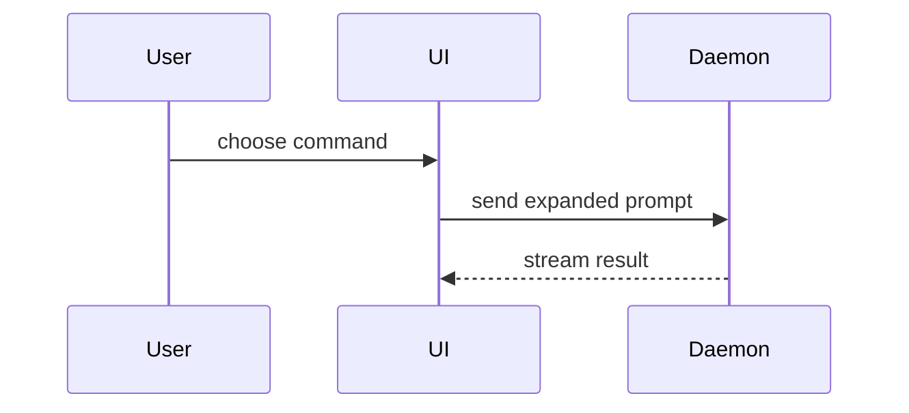

<!-- Forked from mattpocock-skills 1.3.1 `pr` (MIT). See ../THIRD_PARTY_NOTICES.md and CREDITS.md. -->

PR rules (`docs/engineering/issue-workflow.md`):

- Only a **User Story**, **Technical Task** or **Bug** owns a PR. Epics never do; Subtasks return commits to the Story branch.
- Base branch is **`dev`**. Open it as a **Draft** until the diff is coherent and checks have run.
- Reference the Issue with **`Refs #<n>`**. Never `Closes`, `Fixes` or `Resolves`: `dev` is the default branch, so those would close the Issue on merge, before DoD verification.
- Creating or editing a PR is outward-facing: show the body to the operator first unless the handoff already authorizes opening it. Never merge, approve, or mark ready for review on your own.

```bash
gh pr create --draft --base dev --title "<type>: <summary>" --body-file <tmpfile>
gh pr edit <n> --body-file <tmpfile>
```

Use this template for writing the PR body:

```markdown
Refs #<issue>

**Type:** User Story / Technical Task / Bug · **Parent:** #<epic>

## Summary

<diagram, diff-sketch, or tree>

## Acceptance criteria

- [x] <criterion> — <evidence: test name, command, screenshot>
- [ ] <criterion not yet met> — <why>

## Evidence

- **Before:** <screenshot/output/failing test run>
  **After:** <screenshot/output/passing test run>

| Check | Command / CI job | Result |
| --- | --- | --- |
| <e.g. typecheck> | `<exact command>` | PASS / FAIL / NOT RUN / NOT IMPLEMENTED |

## Merge Danger

**Door:** <one-way or two-way>

<optional: description>

**Blast Radius:** <one-word description>

<optional: potential ramifications of merge>

## Review notes

<risks, decisions needing operator approval, skipped checks, contract/migration notes, what the independent reviewer should focus on>
```

## Sections

Skip all preambles and keep prose brief. Use the domain language from `docs/architecture/glossary.md` when it exists.

### Summary

Pick the smallest view that makes the key point clear.

- Show logic or an algorithm as pseudocode:

```text
on(save)
  if content is unchanged
    return cached result
  write new content
  return fresh result
```

- Show runtime control flow as a call tree:

```text
submitForm
  createSession
    persistPrompt
    launchAgent
  navigateToSession
```

- Show UI structure as a component tree, including state and module boundaries that matter:

```text
<SessionPage> (apps/example/src/routes/session.tsx)
  useSessionEvents()
  <SessionToolbar>
    <RunSkillButton> (packages/ui)
```

- Show file responsibility or a broad refactor as a shallow file tree:

```text
src/
├── commands/       # parses user actions
├── sessions/       # owns session state
└── transport/      # sends API requests
```

- Show component interaction, control flow, or data flow with Mermaid:



- Use `diff` when the point is what changes and the surrounding shape already exists. Match the diff shape to the topic.

For a component change:

```diff
 <SessionPage>
   useSessionEvents()
   <SessionToolbar>
+    <RunSkillButton />
   <SessionTimeline>
+    <SkillResultCard />
```

For a file-layout change:

```diff
 src/
 ├── commands/
+│   └── show-me.ts       # expands the slash command
 ├── sessions/
-└── transport.ts
+└── transport/
+    ├── client.ts
+    └── stream.ts
```

For a call-tree or call-stack change:

```diff
 submitForm
   createSession
     persistPrompt
+    expandSkillMention
     launchAgent
-  navigateToSession
+  navigateToSession
+    subscribeToEvents
```

For a state or control-flow change:

```diff
 on(save)
-  write content
+  if content is unchanged
+    return cached result
+  write new content
+  invalidate cache
```

- Show the whole block when most of it is new, when omitted context would hide ownership or order, or when the user needs a copyable target shape:

```ts
function expandSkill(command: string): string {
  const skillName = command.slice(1);
  return `use the ${skillName} skill`;
}
```

#### Guidance

Place each visual next to the short text it supports. Keep only the calls, files, props, states, and boundaries needed to answer the user's current question or the options to resolve the current discussion point.

You may use one of these, you may use several, it is unlikely you will use all of them. Use your judgement and don't overwhelm the user.

### Evidence

Concrete evidence that the change works. Show a before and after.

Screenshots are S-tier - when the environment is set up for it and the change is visual.

Execution-based evidence is A-tier. Test results, console output. Show the exact test that now fails and passes, using pseudocode.

The checks table lists every relevant check from `docs/engineering/quality.md` §8 with its exact command or CI job and result. A script that does not exist yet is `NOT IMPLEMENTED`; a check you didn't run is `NOT RUN`. Never write `PASS` for either. Redact secrets from any pasted output.

### Merge Danger

Describe whether it's a one-way or two-way door. You can walk back through two-way doors, but not one-way doors. A PR that is cheap to roll back is lower risk. Changes that involve destructive actions or hard-to-reverse decisions are one-way doors.

The blast radius is the potential impact or scope of the changes introduced by this PR. Consider all possibilities. Examples are layout shift, breakages for consumers, mobile responsiveness, etc.

Destructive migrations, changes to secrets, auth, provider enablement or architecture gates are one-way doors or high blast radius by default; call them out explicitly so the operator sees them before merging.

### Review notes

Everything the operator and the independent reviewer need that isn't evidence: residual risks, decisions that still need approval, skipped checks with reasons, contract versions and migrations, and where to look first. Keep it short; link to the Issue and docs instead of repeating them.
